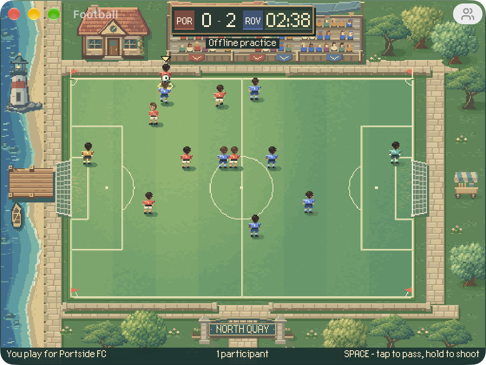

# Football

Play a three-minute game of seven-a-side football at North Quay. Portside FC
wear coral and attack the goal on the right. Rovers wear blue and attack the
goal on the left. Look for the ring under the player you control.

## Kick off

Install Playbit 0.1.3 or later using the [setup instructions](../README.md),
then run `pb run` from the `football` directory. You can play solo with
computer-controlled teammates and opponents.

To play with friends, click **Copy Session Link** in the top right of the game
window and send them the link to open in Playbit. Up to 14 people can play.
Each new player joins the team with fewer people. The computer takes over
when someone leaves.

## Controls

| Action | How to play |
| --- | --- |
| Move | Use the arrow keys, or click or tap a spot on the pitch. Drag to change course. |
| Pass | Face a teammate and tap Space. If a computer-controlled teammate receives your pass, you take control of them. |
| Shoot | Hold Space with the ball. Use the arrow keys to aim. |
| Tackle or switch players | Press Space without the ball. If an opponent is within reach, you'll tackle. Otherwise, you'll switch to an available teammate near the ball. |
| Intercept | Run into the path of a loose ball to collect it. |

You can also tap or hold the action hint below the pitch to pass, shoot, or
tackle. At full time, press Space or tap the result panel to play again with
the same group.

## How it works

- [Match simulation](src/match.ml) advances play 30 times a second. Human and
  computer-controlled players use the same rules for passes, tackles, and shots.
- [Multiplayer](src/session.ml) assigns shirts using Playbit presence. One
  instance runs the match and sends snapshots over a session channel. Other
  instances send their controls and predict their own player's movement between
  snapshots.
- [Pitch artwork](src/art.ml) draws the stadium and player sprites.
  [Match view](src/match_view.ml) adds the scoreboard and action hint.
- [Scorebook](src/scorebook.ml) saves the final score as text under
  `last-result` in the session's shared `scorebook` when a player has write access.
