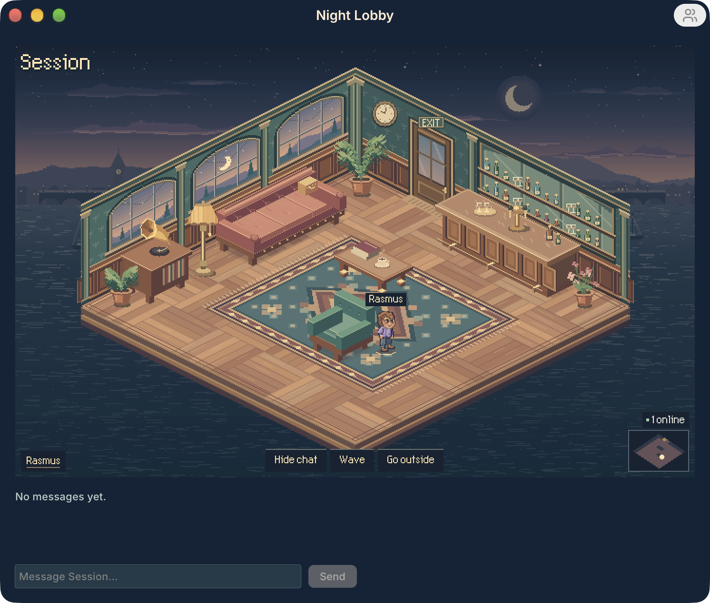

# Night Lobby

Night Lobby is a multiplayer pixel-art hangout by the harbor. Meet friends in
your Session lounge, customize your avatar, or head outside to Lantern Square
to see who's visiting from other sessions in the same World.

## Open Night Lobby

Install Playbit using the [setup instructions](../README.md), then run `pb run`
from the `night-lobby` directory.

To invite friends to your lounge, use the sharing button in the top right of
the window to copy the session link. Send them the link to open in Playbit.

## Controls

| Action | How to play |
| --- | --- |
| Walk | Use the arrow keys with the scene focused, or click a walkable spot. |
| Wave | Press Space or click **Wave**. |
| Change spaces | Walk to the door, or click **Go outside** in the lounge or **Enter Session** in Lantern Square. |
| Chat | Type in the field below the scene and press Return or click **Send**. Use **Hide chat** or **Show chat** to toggle the transcript. |
| Change your avatar | Click your name in the lower left, or right-click the scene and choose **My avatar**. Pick an outfit, skin tone, hair, and accessories, then click **Save avatar**. |

Messages appear in the current space's transcript and briefly above your
avatar. Lantern Square chat is public within the World.

## Set up a shared World

If you're hosting a new World, run `pb session volumes SESSION` after the first
launch, using your session code or link. The `root` entry contains the World
volume ID. With Playbit installed in `/Applications`, run
`python3 configure-world.py WORLD_ID` from `night-lobby` as the World owner.
The script grants public read access to the World and public read and write
access to `world-state` so visitors can move and chat in Lantern Square.

## How it works

- The lounge uses Playbit presence to track who's online and a session channel
  to share live movement, appearance changes, and waves. [Room](src/room.rs)
- Lantern Square shares outdoor avatars, waves, and public chat across
  sessions through `world-state` in the World volume. [Plaza](src/plaza.rs),
  [World keys](src/world.rs)
- The Session volume keeps lounge chat and avatar positions and outfits in
  `room-players`. [Storage](src/storage.rs)
- The scene draws the isometric lounge and square, the animated harbor, and
  the minimap. [Screen](src/screen.rs)
